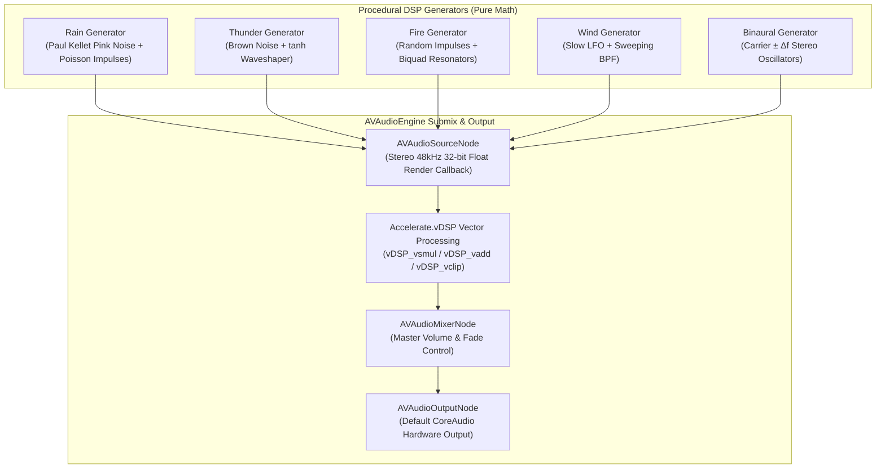

# ARCHITECTURE.md — AuraSound DSP System Architecture

> Digital Signal Processing (DSP) pipeline, audio graph taxonomy, and state coordination for AuraSound.

---

## 🏗️ 1. High-Level DSP Audio Graph



---

## ⚡ 2. Real-Time Audio Render Loop (`AVAudioSourceNode`)

To prevent audio glitches, stutters, and priority inversions on macOS, the real-time render thread operates under strict constraints:
- **Zero Heap Allocations**: No Swift objects, strings, or dynamic arrays allocated inside the render callback.
- **Lock-Free Communication**: Audio parameters (volumes, filter cutoffs) are stored in atomic primitive pointers (`UnsafeMutablePointer<Float>`).

### Render Implementation Pattern
```swift
import AVFoundation
import Accelerate

public final class AuraSoundEngine: @unchecked Sendable {
    private let engine = AVAudioEngine()
    private var sourceNode: AVAudioSourceNode?
    
    // Atomic parameters shared with UI
    public let rainVolume = ManagedAtomic<Float>(0.65)
    public let thunderVolume = ManagedAtomic<Float>(0.20)
    public let fireVolume = ManagedAtomic<Float>(0.40)
    
    public func setupAudioGraph() throws {
        let format = AVAudioFormat(standardFormatWithSampleRate: 48000.0, channels: 2)!
        
        // Generator instances instantiated once on heap
        var rainGen = ProceduralRainGenerator(sampleRate: 48000.0)
        var thunderGen = ProceduralThunderGenerator(sampleRate: 48000.0)
        var fireGen = ProceduralFireGenerator(sampleRate: 48000.0)
        
        sourceNode = AVAudioSourceNode(format: format) { _, _, frameCount, audioBufferList -> OSStatus in
            let ablPointer = UnsafeMutableAudioBufferListPointer(audioBufferList)
            guard ablPointer.count >= 2,
                  let leftBuffer = ablPointer[0].mData?.assumingMemoryBound(to: Float.self),
                  let rightBuffer = ablPointer[1].mData?.assumingMemoryBound(to: Float.self) else {
                return noErr
            }
            
            let count = Int(frameCount)
            
            // 1. Clear output buffers to zero using vDSP
            vDSP_vclr(leftBuffer, 1, vDSP_Length(count))
            vDSP_vclr(rightBuffer, 1, vDSP_Length(count))
            
            // 2. Synthesize and accumulate channels
            rainGen.render(left: leftBuffer, right: rightBuffer, count: count)
            thunderGen.render(left: leftBuffer, right: rightBuffer, count: count)
            fireGen.render(left: leftBuffer, right: rightBuffer, count: count)
            
            // 3. Apply soft limiter ceiling (-0.1 dBFS to prevent DAC clipping)
            var minVal: Float = -0.99
            var maxVal: Float = 0.99
            vDSP_vclip(leftBuffer, 1, &minVal, &maxVal, leftBuffer, 1, vDSP_Length(count))
            vDSP_vclip(rightBuffer, 1, &minVal, &maxVal, rightBuffer, 1, vDSP_Length(count))
            
            return noErr
        }
        
        engine.attach(sourceNode!)
        engine.connect(sourceNode!, to: engine.mainMixerNode, format: format)
        try engine.start()
    }
}
```

---

## 🔬 3. Accelerate vDSP Vectorization

AuraSound harnesses Apple's `Accelerate.framework` for high-throughput SIMD computation:
- `vDSP_vsmul`: Multiplies audio buffer by scalar volume in a single hardware cycle.
- `vDSP_vadd`: Performs vector addition to combine multiple procedural generators without loop overhead.
- `vDSP_biquad`: Runs 2nd-order IIR biquad filters on 48,000 samples/sec with hardware-optimized direct form II transpose architecture.
- `vDSP_vclip`: Clamps audio samples to safe bounds with zero branching penalties.
